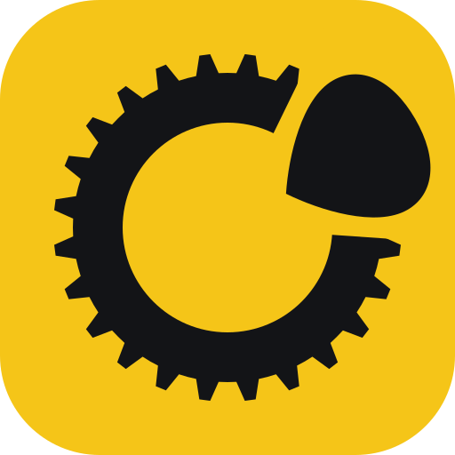
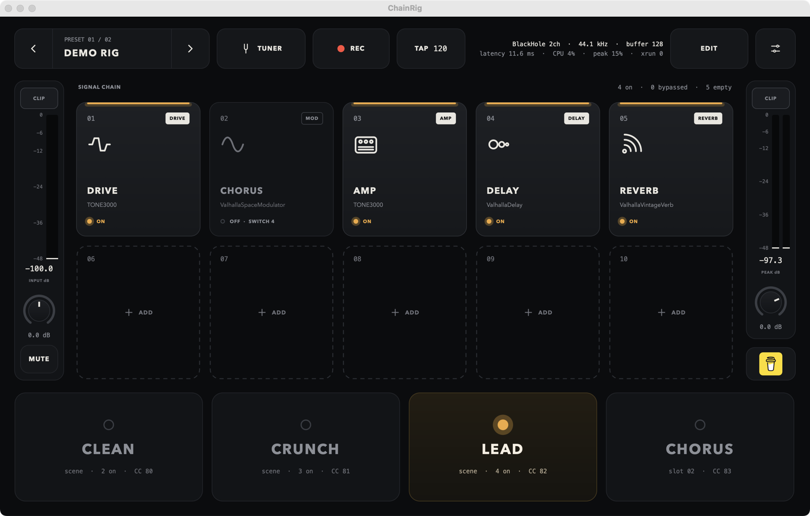

<p align="center"></p>

# ChainRig

A live-performance host for guitarists: a 10-slot VST3 chain, 4 large touch footswitches,
a tuner, MIDI foot controller support, presets, an output meter and a built-in recorder.
Built with JUCE 9 and C++20 for Windows (ASIO) on touch tablets. It also runs on macOS and Linux.



## Download

Get the latest version from the **[Releases page](https://github.com/andreabrunelli93/chainrig/releases/latest)**:

- **Windows** (64-bit): `ChainRig-Windows-x64.zip`. Unzip it and run `ChainRig.exe`. No installer and no extra runtime needed. The app is not code-signed, so Windows SmartScreen may warn you: choose *More info → Run anyway*.
- **macOS** (Apple Silicon and Intel): `ChainRig-macOS.zip`. Unzip it and move `ChainRig.app` to *Applications*. The app is not notarized, so the first time right-click it and choose *Open*, or run `xattr -dr com.apple.quarantine /Applications/ChainRig.app`.

ChainRig checks GitHub for a newer release a few seconds after launch (read-only, no data is sent). When one is available, the status area shows "Update vX.Y.Z available · tap": tap it to open the release page, postpone it, or skip that version. It never interrupts you with a popup. Turn it off or check manually from the Settings menu.

You also need your own VST3 plugins and, on Windows, your audio interface's ASIO driver.

## Features

- **10-slot serial chain.** Tap a slot to pick a plugin from your list. The same menu opens the plugin's editor, bypasses, replaces, moves or removes it. Empty slots are skipped.
- **Built-in NAM slot.** Plays [Neural Amp Modeler](https://www.neuralampmodeler.com) captures (`.nam`, A1 and A2) without a separate plugin, followed by an optional cab IR (`.wav`, `.aif`, `.flac`). Pick **Built-in effects → Amp / Cab → NAM** from the slot menu. The window shows the capture's name, gear and author, and has **Normalize** (brings captures to a similar volume, from the loudness stored in the file), **Lite** for A2 captures (the smaller model inside the file, for slower computers), input and output gain, and an IR on/off switch. Switching capture crossfades, so it doesn't click. Captures recorded at 48 kHz are resampled when the interface runs at another rate. The slot shows the capture's name. If a preset refers to a capture or IR that isn't at its saved path (for example a preset copied from another computer), ChainRig looks for a file with the same name in `Documents/ChainRig/Tones` and its subfolders.
- **Drag to reorder.** Drag a slot onto an empty slot to move it there, or onto an occupied slot to insert it and shift the others. Footswitch assignments follow the plugins.
- **Built-in pedals.** Analog pedals and a tape machine that run inside ChainRig, with the same knobs as the real thing, under **Built-in effects** in the slot menu. See [Built-in pedals](#built-in-pedals) below.
- **Slot name and type.** From the slot menu: **Rename...** (leave empty to go back to the plugin name) and **Type**: amp, cab/IR, drive, compressor, EQ, modulation, delay, reverb, tape, other. The type sets the slot's icon and tag. "Automatic" guesses it from the plugin's category and name. Name and type are stored in the preset.
- **4 large footswitches, switch or scene.** In **switch** mode a footswitch turns its assigned slots on and off and shows their names (for example "DRIVE + DELAY"). A slot assigned to a switch only plays while that switch is on.
  In **scene** mode it recalls a snapshot of which slots are on and which are off (for example CLEAN, CRUNCH, LEAD). Only one scene is lit at a time. In edit mode, tap the footswitch and choose **Mode**, then **Save current on/off to this scene**. Scenes are stored in the preset, so every rig has its own.
- **Tuner** (YIN). It works on the input, before the chain, and mutes the output while you tune. It shows the note, octave, cents, frequency and the nearest standard-tuning string.
- **Gapless preset switching.** Plugins already in the chain are kept (even if they move to another slot) and only receive the new settings. New plugins are created while the old chain keeps playing, then the chain is swapped in one step with a short fade (about 8 ms out, 30 ms in), so loading, moving or removing a plugin never clicks. Delay and reverb tails are not affected by the fade.
- **Delay and reverb tails ring out.** When you change preset, delays and reverbs that were playing keep ringing with their old settings (they get no new input) for about 12 seconds and then fade out, while the new preset already plays. If the new preset uses the same delay or reverb with the same settings, it simply carries on. Turn it off in **Settings → Let delay and reverb tails ring out on preset change**. A slot counts as delay or reverb by its type (set it from the slot menu if "Automatic" guesses wrong).
- **Presets.** One readable JSON file (`.chainrig`) per preset, in `Documents/ChainRig/Preset`. A preset stores every plugin with its full state, the bypass states, slot names and types, footswitch modes, assignments and scenes, and the tempo. Switch presets with `<` / `>` or over MIDI.
- **Setlists.** An ordered list of songs for the gig, each with its preset (the same preset can be used by several songs). Create one from the preset menu: **Setlist → New setlist...**, add songs, name them and pick their presets. While a setlist is active, `<` / `>`, the MIDI next/previous pedals and Program Change follow the songs, and the preset area shows the song name, its number and the preset. The setlist stops at the first and last song instead of wrapping around. Setlists are small JSON files (`.chainset`) in `Documents/ChainRig/Setlists` that refer to presets by name, so they work on any computer with the same presets. **Setlist → No setlist** goes back to all presets.
- **Unsaved changes.** An amber dot and "UNSAVED" next to the preset name show changes since the last save: plugins loaded, moved or removed, bypass, names, types, footswitch assignments, tempo, and parameter changes inside a plugin. Turning footswitches on and off does not count. Switching preset from the touch screen asks whether to save first. Switching from a MIDI controller never asks, so it cannot block you on stage.
- **Crash recovery.** Every 10 s, if something changed, the full chain is written to a recovery file next to the settings. A clean exit deletes it. If ChainRig closed unexpectedly, the next launch restores the chain as it was and tells you. If restoring itself crashes (for example a plugin that crashes on load), the following launch skips it and opens the last preset instead.
- **Tempo (BPM).** Each preset sends a tempo to the plugins, so tempo-synced delays and reverbs behave. Set it from the preset menu (**Tempo: 120 BPM...**), or tap it: the **TAP** button in the top bar (or a MIDI pedal) averages your last taps. Tapping counts as live use, not as an unsaved change.
- **Plugin chooser.** Tick only the plugins you use live. The others are never loaded, which matters if you have hundreds of plugins installed.
- **Crash-safe plugin scan.** Each plugin is scanned in a separate process. If one hangs for more than 30 s or crashes, it is excluded and ChainRig carries on.
- **Input strip** (left): input level after gain, with a latching **CLIP** light, an input **gain** knob (-24 to +24 dB, double-tap for 0 dB, saved in the settings) and an input **MUTE**. Muting the input lets delay and reverb tails ring out.
- **Output meter** (right) with peak hold, a latching **CLIP** light and a master **volume** knob (-60 dB = muted, up to +12 dB, double-tap for 0 dB, saved in the settings). The meter and the recorder follow the volume. Tap either meter to reset it.
- **Recorder.** **REC** writes the output (channels 1-2, i.e. the whole chain) to a 24-bit stereo WAV file in your Downloads folder.
- **Low latency.** ASIO on Windows, Core Audio on macOS. The top bar shows the estimated latency, the CPU load, the peak load of a single audio block and the xrun count.

## Built-in pedals

Pick them from the slot menu: **Built-in effects → category → pedal**. They load like any plugin, save into presets, and open a pedal-style window with the knobs. Most are simulated from their schematics: the circuit is solved sample by sample (nodal DK method), so the drive and compression react to how hard you play, unlike an impulse response. Pedal names refer to the circuits they model; the window artwork is original.

| Menu | Pedal | What it is | Controls |
|---|---|---|---|
| Distortion / Overdrive | **Centurion Klone** | Transparent overdrive: the clean signal blended with a germanium-diode clipped path through a dual-gang gain control, active treble, 18 V headroom. The Gain curve is measured against calibrated captures of a hardware unit. | Gain, Treble, Output |
| Distortion / Overdrive | **Tube Screamer** | Op-amp overdrive with silicon diodes in the feedback loop: a 720 Hz high-pass ahead of the clipping keeps the bass tight, the clean signal passes under the soft clipping, then a 723 Hz low-pass and an active tone control. Drive curve and diodes matched to calibrated captures. | Drive, Tone, Level |
| Distortion / Overdrive | **ShredMaster** | High-gain op-amp distortion: two gain stages (up to about 65 dB) that clip on the op-amp rails, silicon diodes to ground, a passive bass/treble stack and a Contour control that scoops the mids (down to about -23 dB around 700 Hz). The original 1 nF filter in the last stage makes it dark. | Gain, Bass, Contour, Treble, Volume |
| Dynamics | **Dyna Comp** | OTA compressor modelled from its circuit, with treble pre-emphasis, a two-transistor full-wave detector, a fast attack (and its click) and a release of about 1.5 s. Like the hardware it is a bit dark and has little output. | Sustain, Level, Blend (clean signal mixed in for the pick attack; 10 = original) |
| Dynamics | **Empress Compressor** | Studio-style VCA compressor with feedback detection: an original design with the reference pedal's controls (its schematic is not public), transparent, no tone change from the compression. | Input, Output, Mix, Attack (50 µs – 50 ms), Release (50 ms – 1 s), Tone (tilt around 500 Hz); Ratio 2:1 / 4:1 / 10:1, SC HPF |
| Modulation | **Small Clone** | Bucket-brigade chorus: treble pre-emphasis, anti-aliasing and reconstruction filters around a 1024-stage delay line, a clock swept by a triangle LFO, de-emphasis mixed with the dry signal. | Rate (0.4 – 9.5 Hz), Depth |
| Modulation | **SCF Chorus** | Stereo bucket-brigade chorus with compander noise reduction (2:1 before the delay line, 1:2 after it), a linear clock oscillator swept by a comparator LFO. Chorus mode only. | Speed (0.1 – 10 Hz), Width, Intensity, Gain; Stereo |
| Modulation | **TR-2 Tremolo** | VCA tremolo from its schematic: a triangle LFO (90 – 900 ms period) that the Wave control squares off by clipping, and a 10 ms filter on the VCA control so even the square wave doesn't click. | Rate, Wave (triangle → square), Depth |
| Delay | **Space Echo RE-201** | Three-head tape echo following the original block diagram, on the same tape model as the EP-3: head 1 at 69 – 177 ms, heads 2 and 3 at twice and three times that, Intensity taken before the tone controls, repeats that darken as the tape slows, tape hiss (60 dB S/N), wow and flutter. Past Intensity 7 it self-oscillates, held back by tape and amplifier saturation. No spring reverb. | Input, Rate, Intensity, Echo, Bass, Treble (repeats only), Wow; Heads 1 / 2 / 3 / 2+3 / 1+2 / 1+2+3 |
| Tape | **Echoplex EP-3** | Physical model of magnetic tape (no echo): record pre-emphasis, the tape's hysteresis (Jiles-Atherton), playback-head losses and head bump that depend on the tape speed, wow and flutter. Mostly third-harmonic saturation that grows smoothly with your playing. | Drive (level compensated), Bias, Wow, Level; Speed 7.5 / 15 / 30 ips |
| Amp / Cab | **NAM** | Neural Amp Modeler captures with an optional cab IR (see above). | Capture, IR, levels |

Notes:

- **Level.** With the default knobs each pedal plays close to the bypass level. The Dyna Comp and the Tube Screamer, like the hardware, need Level around 8.
- **SCF Chorus Stereo switch.** Off (default): both outputs carry dry + effect, safe in a mono chain such as before an amp capture. On: the effect is in anti-phase between left and right, for stereo rigs after the amp (summed to mono it cancels).
- **Space Echo Rate.** Turning it glides the delay time (the motor and the tape have inertia), like the hardware.
- **Echoplex EP-3 Bias.** Low = under-biased tape, dirtier and looser; 5 = properly biased.
- **CPU.** Each pedal uses between 0.1% and about 2% of an audio block on a recent laptop.

## Building

JUCE 9.0.6 is downloaded automatically with CMake FetchContent. Use `-DJUCE_PATH=/path/to/JUCE` to build against a local copy instead.

### Windows

Requires Visual Studio 2022 or newer with the "Desktop development with C++" workload, and Git.

```
cmake -B build -A x64
cmake --build build --config Release
```

The executable is `build\ChainRig_artefacts\Release\ChainRig.exe`. It is linked against the static C++ runtime, so no redistributable is needed.

The GitHub Actions workflow in `.github/workflows/build.yml` builds Windows and macOS on every push (zips under *Actions → run → Artifacts*). Pushing a version tag such as `v0.2.0` also publishes both zips as a GitHub Release.

### macOS

Requires the Xcode command line tools (`xcode-select --install`) and CMake (`brew install cmake`).

```
cmake -B build -DCMAKE_BUILD_TYPE=Release
cmake --build build -j8
open build/ChainRig_artefacts/Release/ChainRig.app
```

On first launch macOS asks for microphone permission. Allow it, otherwise the guitar input stays silent. You can change it later in *System Settings → Privacy & Security → Microphone*.

Only VST3 plugins are hosted. Audio Units are disabled (`JUCE_PLUGINHOST_AU=0`).

## First run

1. **Settings → Audio device...**: choose **ASIO** on Windows or **CoreAudio** on macOS, then your interface. 48 kHz with a 64-256 sample buffer is a good start.
2. **Settings → Guitar input**: pick the input your guitar is plugged into.
3. **Settings → Choose plugins...**: filter by name, tick the plugins you use live and press **APPLY**. **None** unticks everything visible. **Advanced...** opens JUCE's full plugin list, where you can add custom folders.
4. Tap an empty slot → **Choose plugin** to load a plugin.
5. **EDIT** → tap a footswitch to choose the slots it controls, or switch it to scene mode and save the current on/off state. Tap **EDIT** again to leave edit mode.
6. Tap the preset name → **Save as...**.

For the stage: **Settings → Full screen**. On Windows you can put a shortcut to `ChainRig.exe` in the startup folder (Win+R → `shell:startup`), so it starts full screen on the last preset.

## Preparing a Windows machine for the stage

1. **Audio interface driver.** Install the manufacturer's ASIO driver and choose it in ChainRig (type **ASIO**). Avoid the generic Windows audio driver for live use.
2. **Power.** *Settings → System → Power*: power mode "Best performance", and screen/sleep "Never" while plugged in. In the classic Control Panel power options, set *USB settings → USB selective suspend* to *Disabled*.
3. **System sounds.** Set the Windows default output to the built-in speakers, not to your interface, and choose the "No sounds" scheme. Turn on *Do not disturb*. Otherwise notifications, browser tabs and other apps play through your rig.
4. **Plugins.** Install your VST3 plugins in `C:\Program Files\Common Files\VST3`, then use **Choose plugins...** to pick only the ones you need.
5. **Presets from another computer.** Copy the `.chainrig` files to `Documents\ChainRig\Preset`. Reload any amp captures or IR files that use file paths inside the plugin, then save the preset again.
6. **First launch.** Windows SmartScreen may warn about an unrecognised app: choose *More info → Run anyway*.
7. **Before the gig.** Play for 20-30 minutes with your real presets and watch "peak" and "xrun" in the top bar. If xruns appear, raise the buffer one step. Consider airplane mode (unless you use Bluetooth MIDI) and close other applications.

## MIDI foot controllers (USB or Bluetooth)

All MIDI inputs are enabled automatically, including those connected after launch.

| Action | Default message |
|---|---|
| Footswitches 1-4 | CC 80, 81, 82, 83 |
| Tuner | CC 84 |
| Tap tempo | CC 87 |
| Next / previous preset (or song, with a setlist) | CC 85 / CC 86 |
| Preset number N (alphabetical order), or song N+1 with a setlist | Program Change N |

In **Settings → MIDI foot controller** choose how CC values are read:
- **Momentary**: each press toggles. For controllers that send 127 on press and 0 on release.
- **Absolute**: the value decides (127 = on, 0 = off). For controllers that alternate 127 and 0.

To change the CC numbers, quit ChainRig and edit `cc_button1`…`cc_button4`, `cc_tuner`, `cc_nextPreset` and `cc_prevPreset` in the settings file:
- Windows: `%APPDATA%\ChainRig\ChainRig.settings`
- macOS: `~/Library/Application Support/ChainRig/ChainRig.settings`

Bluetooth: controllers sold with their own USB dongle work out of the box. For native Windows Bluetooth LE MIDI, build with `-DCHAINRIG_BLUETOOTH_MIDI=ON` and pair the controller in Windows first.

## Troubleshooting

- **Clicks or dropouts.** Watch "peak" (the load of the slowest audio block) and "xrun" in the top bar. Above 100%, a block took longer than the buffer allows. Some plugins have occasional CPU spikes even when the average load is low. Try a larger buffer or another plugin. Events are logged to `scan.log`, next to the settings file. Start ChainRig with `CHAINRIG_LEVEL_LOG=1` to also log input and output levels every 500 ms.
- **A tempo-synced delay repeats far too late.** Set the preset tempo. Without a tempo, VST3 plugins receive 0 BPM.
- **Sounds you didn't play.** Check that no other application is playing to, or recording from, the same interface. Your OS system sounds are best sent to a different output.

## Known limitations

- Loading a plugin that is not already in the chain still takes a moment (the old chain keeps playing meanwhile). Plugins that load large files in their state, such as amp captures, may briefly glitch while switching if their settings change. Bypass and footswitches are click-free.
- A plugin crash while playing takes down the whole application.
- File paths stored inside third-party plugin states (amp captures, IRs) differ between machines and must be reloaded after moving a preset to another computer. The built-in NAM slot finds them again if you put the files in `Documents/ChainRig/Tones`.

## Code structure

- `Source/Engine.*`: audio device, processing graph (input → tuner → slots → output), bypass, footswitches, MIDI, presets, tempo, audio health checks.
- `Source/NamProcessor.*`: the built-in NAM slot (capture, resampling, IR, gains, its window).
- `Source/BuiltIns.*`: the list of built-in effects and the "Built-in" plugin format that creates them.
- `Source/Pedals/`: built-in pedals. `CircuitModel.h` solves a circuit (nodes, ideal op-amps, one diode pair between any two nodes) with the nodal DK method; `Taper.h` has the pot curves; `EnvelopeDetector.h` models transistor envelope detectors; `BbdDelay.h` has the bucket-brigade delay line and the triangle LFO; `Compander.h` the NE570-style compander; `TapeHysteresis.h` the magnetic tape (Jiles-Atherton hysteresis), used by `TapeMachine` and `TapeEcho`; `VcaCompressor` the studio-style compressor; pedals can have stereo outputs (`Info::stereoOutput`); `PedalProcessor` handles knobs, switches, multi-position selectors, state, oversampling and the window (`PedalEditor.cpp`, artwork in `Artwork.*`); one file per pedal. `Tools/PedalSnapshot.cpp` saves a pedal window as a PNG. `Tools/PedalLabRender.cpp` renders a WAV through a pedal offline and times it (`-DCHAINRIG_PEDAL_LAB=ON`).
- `Source/Recorder.h`: the audio callback wrapper. It runs the graph, then feeds the meter, the diagnostics and the WAV writer.
- `Source/Tuner.h`: tuner node, lock-free FIFO to the UI, YIN pitch detection.
- `Source/PluginScanner.h`: out-of-process plugin scanning.
- `Source/PluginChooser.*`: the "choose plugins" window.
- `Source/UpdateChecker.h`: background check of the latest GitHub release.
- `Source/Look.*`: colours, fonts, icons, look and feel, top-bar buttons.
- `Source/MainComponent.*`: the touch UI (preset selector, slots, footswitches, meter, tuner overlay, plugin windows).
- `Source/Main.cpp`: application, main window and the scanner child process entry point.

## Changelog

See [CHANGELOG.md](CHANGELOG.md).

## License

ChainRig is free software, released under the [GNU Affero General Public License v3.0](LICENSE) (AGPL-3.0).

It is built on [JUCE](https://juce.com), used under JUCE's open-source (AGPLv3) licence. If you distribute a modified version, you must make its source code available under the same licence. Plugins you load in ChainRig are separate products with their own licences.

The built-in NAM slot uses [NeuralAmpModelerCore](https://github.com/sdatkinson/NeuralAmpModelerCore) (MIT) and its dependencies [Eigen](https://eigen.tuxfamily.org) (MPL-2.0), [AudioDSPTools](https://github.com/sdatkinson/AudioDSPTools) (MIT, with a resampler from iPlug2/WDL under the zlib-style licence) and [nlohmann/json](https://github.com/nlohmann/json) (MIT). They are downloaded at build time.

## Support

ChainRig is free. If it helps you on stage, you can buy me a coffee:

<a href="https://buymeacoffee.com/andreabrunelli"></a>
